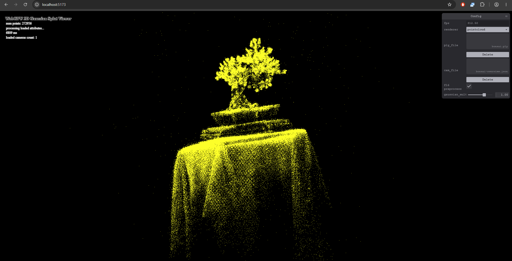

# WebGPU Gaussian Splat Viewer

**Rithik Rajaram** — University of Pennsylvania, CIS 565: GPU Programming and
Architecture, Project 5.

A browser-based viewer for pretrained 3D Gaussian scenes. It projects anisotropic
Gaussians into screen-space ellipses, evaluates their view-dependent colors,
sorts them on the GPU, and composites their splats using alpha blending. A yellow
point-cloud renderer provides a comparison with the underlying point positions.

[Live demo](https://rithikr.github.io/Project5-WebGPU-Gaussian-Splat-Viewer/) ·
[Repository](https://github.com/RithikR/Project5-WebGPU-Gaussian-Splat-Viewer) ·
[Performance analysis](#performance-analysis)

The live-demo URL is the GitHub Pages destination. The deployment workflow
publishes it after Pages is configured and the finished changes are pushed.

## Implemented features

- **Part 1:** model/view/projection transformation in the provided point-cloud
  shader, rendering the scene's points in yellow.
- **Part 2 preprocessing:** packed input decoding, view-frustum culling with a
  20% lateral guard band, quaternion normalization, exponential scale decoding,
  Gaussian scaling, 3D covariance, perspective covariance projection, inverse
  conics, three-sigma quad bounds, sigmoid opacity, and spherical-harmonic color
  evaluation through degree 3.
- **Part 2 rendering:** GPU visibility compaction, the provided radix sorter in
  back-to-front depth order, a GPU-generated indirect instance count, reconstructed
  quad vertices, exponential Gaussian opacity falloff, and alpha blending.
- **Controls:** switch renderers, adjust Gaussian size, move the camera, load
  camera presets, and resize the viewport.
- **f16 extra credit:** selectable half-precision preprocessing arithmetic,
  compressed 32-byte splats, and an automatic f32 fallback.

## Screenshots



## Demo video/GIF

[Watch the viewer demonstration](images/demo.mp4)

## Run locally

Tested on **Windows 11 Home**, **Intel Core i9-12900K**, **32 GB RAM**, an
**NVIDIA GeForce RTX 3080 Ti**, and **Google Chrome 156.0.8078.48**.
The production build was tested with **Node.js 24.22.0**.

```sh
npm ci
npm run dev
```

On PowerShell installations that block `npm.ps1`, use `npm.cmd` instead of `npm`.
Open the local URL printed by Vite in a WebGPU-capable browser. Loading a PLY
does not require a camera file; a matching camera preset is useful when the
default camera starts inside the scene.

Download the pretrained PLY and matching camera JSON files from the
[assignment scene folder](https://drive.google.com/drive/folders/1Fz0QhyDU12JTsl2e7umGi5iy_V9drrIW?usp=sharing).
Use the `ply_file` picker to load the PLY and select `gaussian` or `pointcloud`.
Use the `cam_file` picker to load a camera JSON file that matches the scene.
Files are read locally by the browser; pretrained scenes are not bundled into
the deployment.

| Control | Action |
| --- | --- |
| Left mouse drag | Rotate the camera |
| Right mouse drag | Pan the camera |
| Mouse wheel | Move forward/backward |
| Keys `0`–`9` | Select an available loaded camera preset |
| `gaussian_multiplier` | Change Gaussian size; zero hides splats |
| `f16 preprocess` | Switch between f16 and f32 preprocessing when supported |

Create and preview a production build with:

```sh
npm run build
npm run preview
```

## Performance analysis

Measurements below were collected on the hardware above on **October 27, 2026**.
The measurements use the supplied **272,956-Gaussian bonsai**, degree-3 SH, a
Gaussian multiplier of 1, and a **1280 x 720** offscreen render target. It records
GPU timestamps in an isolated headless Chrome session. Each case has three
rounds with at least 60 frames and 500 ms of warmup per round, followed by 90
recorded frames per round. Case order rotates between rounds.

All table times are **medians in milliseconds** over 270 samples. They exclude
file loading, pipeline compilation, CPU recording/readback, and browser
presentation. They describe GPU latency rather than the viewer's end-to-end
FPS. The on-screen FPS monitor also includes browser scheduling and should not
be compared directly with these numbers. Browser timestamp quantization remains
enabled; very small timing differences are not evidence of a meaningful speedup.

The input PLY's SHA-256 is
`61a368d0fd49772a3b6b47f621367805034fb1d21f87bdf62a1d22d697a56444`.
The settings for each comparison are described below.

### Point-cloud versus Gaussian rendering

| Renderer, full scene / overview camera | GPU frame time |
| --- | ---: |
| Yellow point cloud | 0.0594 |
| Gaussian, f32 preprocessing | 1.0025 |

The point cloud displays isolated, uniformly yellow pixels. It shows the spatial
distribution of points, but lacks the scene's learned color, scale, orientation,
and transparency. Gaussian rendering fills surfaces with colored ellipses and
combines overlapping splats into a smoother reconstruction. SH evaluation makes
the color depend on the viewing direction.

The Gaussian frame is about **16.9 times** the GPU cost of the point-cloud frame
in this view. The point renderer performs one inexpensive point-list draw. The
Gaussian renderer additionally evaluates covariance and SH, compacts visible
indices, executes radix sorting, and blends many fragments per splat. The extra
work produces the improved reconstruction.

### Effect of preprocessing workgroup size

The scene, camera, precision, and culling setting are identical. Only the
preprocessing workgroup size changes; radix-sort workgroups stay at 256 threads.

| Threads per preprocessing workgroup | Preprocess time | GPU frame time |
| ---: | ---: | ---: |
| 64 | 0.0614 | 0.9984 |
| 128 | 0.0696 | 1.0015 |
| 256 | 0.0696 | 1.0025 |

Using 64 threads reduces preprocessing time by about **12%** relative to 256,
but total frame time changes by only about **0.4%**. Sorting and rasterization
dominate this frame, so a small preprocessing improvement has little effect on
the total. The default remains 256 rather than selecting a configuration from
a small difference on one GPU.

A plausible explanation for the preprocessing difference is the balance between
workgroup scheduling and register usage: each thread computes a complete
Gaussian, and smaller workgroups can allow a different occupancy/resource
balance. This is an interpretation of the timings; register occupancy was not
profiled. Increasing workgroup size does not automatically make this shader
faster, and another GPU or scene can favor a different size.

### Effect of view-frustum culling

The overview camera is at `(0, 0, -7)` and the close camera is at `(0, 0, 0)`,
both with identity rotation. The culling comparison disables only the lateral
guard-band test. Near/far clipping, opacity rejection, and covariance validity
checks remain enabled in both cases, so the retained count can be below the
original input count even with lateral culling off.

| Camera | Lateral culling | Retained Gaussians | GPU frame time |
| --- | --- | ---: | ---: |
| Overview | On | 270,194 | 1.0025 |
| Overview | Off | 270,385 | 1.0035 |
| Close | On | 7,482 | 1.6835 |
| Close | Off | 163,159 | 2.6609 |

In the overview, nearly all eligible centers are already on screen. Culling
removes only 191 additional centers, and its timing benefit is negligible. In
the close view, culling removes about **95.4%** of otherwise eligible centers
and reduces GPU frame time by about **36.7%**.

The compute shader still visits every input point, but early rejection skips
covariance/SH work and reduces indirect draw instances and fragment blending.
The provided sorter's padding cleanup still depends on the allocation for the
input scene, and its fixed passes/dispatches retain overhead, so sorting time
does not shrink in proportion to the retained count. In the close view, the
largest measured improvement is in rasterization: **2.1309 ms to 1.1407 ms**.

The close view remains slower than the overview despite retaining fewer
Gaussians because nearby splats cover more pixels and cause more overdraw.
Center-count reduction alone does not predict fragment cost.

### Effect of Gaussian count

These are deterministic, evenly spaced subsets of the same file, with the
overview camera, f32 preprocessing, 256-thread workgroups, and culling enabled.

| Input Gaussians | Retained Gaussians | Preprocess time | Raster time | GPU frame time |
| ---: | ---: | ---: | ---: | ---: |
| 68,239 | 67,582 | 0.0205 | 0.1106 | 0.5908 |
| 136,478 | 135,093 | 0.0420 | 0.2191 | 0.7240 |
| 272,956 | 270,194 | 0.0696 | 0.4372 | 1.0025 |

More Gaussians increase input reads, covariance/SH work, sorting data, instance
count, and overlapping fragments. Rasterization approximately doubles with
each doubling of the sampled count in this view. The total grows by about
**1.70 times** when the input grows by four times, because fixed pass/dispatch
overhead is a large part of this relatively small scene: sorting takes roughly
**0.45–0.49 ms** across these cases. Memory allocation also grows with the input
count. Larger scenes and camera poses with different splat sizes can scale
differently.

### f16 extra-credit comparison

| Camera | Preprocessing arithmetic | Preprocess time | GPU frame time |
| --- | --- | ---: | ---: |
| Overview | f32 | 0.0696 | 1.0025 |
| Overview | f16 / mixed precision | 0.0707 | 1.0030 |
| Close | f32 | 0.0266 | 1.6835 |
| Close | f16 / mixed precision | 0.0266 | 1.6824 |

These measurements show **no clear frame-time speedup** from f16 arithmetic on
this GPU/scene. Both modes use the same packed output layout, and sorting and
rasterization dominate the workload. The compression benefit is explicit:
32 bytes per preprocessed splat instead of 48 bytes for three f32 `vec4`s,
reducing this buffer by **33.3%**, or approximately **4.17 MiB** for this scene.
This is a splat-buffer saving, not a 33.3% reduction in total GPU memory.

## Half-precision implementation

The renderer compiles the shared preprocessing shader with `Scalar = f16` and
`enable f16;` when `shader-f16` is available, or with `Scalar = f32` otherwise.
The f16 path performs quaternion rotation, normalized scale-factor arithmetic,
and SH color evaluation in half precision. Both modes store sizes, RGB, and
opacity as packed f16 values in a shared 32-byte splat record.

Quaternion normalization, camera projection, covariance formation/inversion,
and sorting depth retain f32 precision. Scale factors are normalized before
f16 arithmetic; axes below f16's normal range are recovered in f32 so GPUs
that flush subnormals do not erase thin axes. Screen-space centers and conics
also remain f32. These choices preserve thin axes in the tested extreme-scale
cases while still using f16 arithmetic and compressed output.

The **f16 preprocess** checkbox is enabled by default on supported devices and
switches precision without reloading the scene. It is disabled on devices that
use the automatic f32 fallback.
